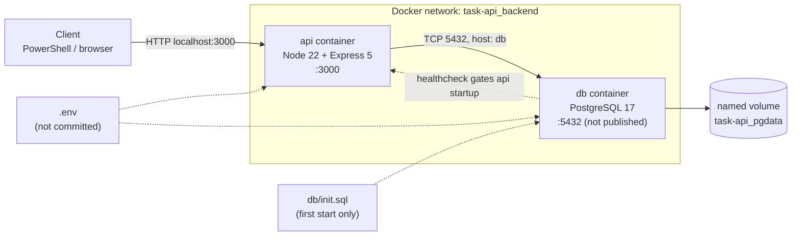

# Architecture diagram specification

Use this to draw the diagram in draw.io or Excalidraw. A Mermaid version is included at the bottom, which GitHub renders automatically.

## Canvas and layout

Landscape, left to right: **Host -> Docker network box -> Volume**. Use three zones.

## Components

| ID | Label | Shape | Details |
|---|---|---|---|
| H | Developer machine (Windows) | Rounded rectangle, outermost | Runs Docker Desktop |
| C | Client (PowerShell / browser) | Small box inside H, far left | Sends HTTP requests |
| N | Docker network `task-api_backend` | Large dashed rectangle inside H | Contains both containers. Bridge network |
| A | `api` container | Box inside N | Node.js 22 Alpine, Express 5, user `node` (uid 1000), listens on 0.0.0.0:3000 |
| D | `db` container | Box inside N | PostgreSQL 17 Alpine, listens on 5432 |
| V | Named volume `task-api_pgdata` | Cylinder, outside N but inside H | Mounted at `/var/lib/postgresql/data` in D |
| I | `db/init.sql` | Small document icon | Bind-mounted read-only into D at `/docker-entrypoint-initdb.d/01-init.sql`. Runs only on empty volume |
| E | `.env` | Small document icon, left of N | Read by Compose. Never committed. Feeds environment variables to A and D |

## Connections

| From | To | Style | Label |
|---|---|---|---|
| C | A | Solid arrow | `HTTP :3000` (published port `localhost:3000 -> 3000`) |
| A | D | Solid arrow | `TCP 5432, host "db"` (internal DNS) |
| D | V | Solid arrow | `database files` |
| I | D | Dotted arrow | `schema on first start` |
| E | A | Dotted arrow | `DB_* variables` |
| E | D | Dotted arrow | `POSTGRES_* variables` |
| D | A | Dashed arrow, label "gates startup" | `healthcheck: pg_isready (5s interval)` |

## Ports

- Published to host: **3000** only (variable `API_PORT`, default 3000).
- **5432 is NOT published.** Draw a small "no entry" marker on D's edge toward the host, labeled "not exposed".

## Startup sequence (optional second panel)

1. Compose creates network and volume.
2. `db` starts and runs its health check until `healthy`.
3. `api` starts (`depends_on: condition: service_healthy`).
4. API serves `/health` (liveness) and `/health/ready` (readiness, runs `SELECT 1`).

## Colors (suggested)

API container blue, database container green, volume orange, config files grey, network boundary dashed black.

## Mermaid version

